# Explainable CNN for Fashion Image Classification

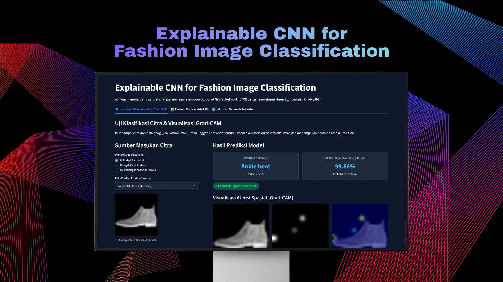


## Project Overview

Explainable CNN for Fashion Image Classification is a PyTorch deep learning project for multi-class apparel image recognition and spatial attribution analysis on the Zalando Research Fashion-MNIST benchmark. The repository compares three progressively richer neural architectures—a Baseline Multilayer Perceptron (`BaselineMLP`), a two-stage `StandardCNN`, and a regularized dual-convolution `RegularizedCNN`—to evaluate how 2D spatial inductive bias, normalization, dropout, and lightweight spatial augmentation impact generalization across 10 garment and footwear categories. To eliminate opaque black-box predictions, the pipeline integrates Gradient-weighted Class Activation Mapping (`GradCAM`) hooked to the final convolutional layer (`conv4`), producing localized heatmaps alongside a dark-themed Streamlit interface for interactive inference and error diagnostics.

## Problem Statement & Objectives

Classifying low-resolution `28 x 28` grayscale apparel silhouettes poses significant fine-grained visual ambiguity, particularly among upper-body garments (`T-shirt/top`, `Pullover`, `Coat`, and `Shirt`) that share overlapping torso outlines and lack color or high-frequency texture cues. In addition, standard convolutional classifiers provide class probabilities without revealing which spatial regions drive correct predictions or systematic confusion pairs.

- **Empirical Architecture Comparison:** Benchmark a flattened `BaselineMLP`, an unregularized `StandardCNN`, and a `RegularizedCNN` with Batch Normalization, Dropout, and reflection-padded augmentation under identical data splits and optimization budgets.
- **Strict Anti-Leakage Evaluation:** Verify raw IDX binary integrity via MD5 checksums, enforce zero duplicate overlap, compute normalization statistics exclusively from the training partition, and isolate the `10,000`-sample test set for single-pass final evaluation.
- **Spatial Explainability via Grad-CAM:** Extract gradient-weighted convolutional activation maps from `conv4` to inspect attention alignment on both confident predictions and top confusion pairs.
- **Interactive Diagnostic Application:** Provide a reproducible CLI training/evaluation suite, automated `pytest` verification, and a dark-mode Streamlit interface for live image upload, probability inspection, and Grad-CAM visualization.

## Data & Input Sources

This project exclusively uses the official **Fashion-MNIST** dataset released by Zalando Research, stored locally as four compressed IDX binary files inside [`dataset/original/`](dataset/original). Before training, [`src/data.py`](src/data.py) validates IDX magic numbers (`2051` for images, `2049` for labels), payload byte lengths, pixel intensity bounds (`[0, 255]`), absence of all-zero images, per-image MD5 uniqueness (`60,000` unique train images, `10,000` unique test images, `0` train-test duplicates), and official file MD5 checksums.

| Attribute | Value |
|---|---|
| **Dataset / Input Source** | Zalando Research Fashion-MNIST |
| **Source** | [`dataset/original/`](dataset/original) (`train-images-idx3-ubyte.gz`, `train-labels-idx1-ubyte.gz`, `t10k-images-idx3-ubyte.gz`, `t10k-labels-idx1-ubyte.gz`) |
| **Format** | Gzipped IDX3-ubyte (images) & IDX1-ubyte (labels) |
| **Samples / Records** | `70,000` total (`54,000` Train / `6,000` Stratified Validation / `10,000` Isolated Test) |
| **Features / Input Shape** | `(1, 28, 28)` single-channel grayscale tensor (`uint8` `[0, 255]` normalized to `float32`) |
| **Target / Label** | `10` balanced classes (`T-shirt/top`, `Trouser`, `Pullover`, `Dress`, `Coat`, `Sandal`, `Shirt`, `Sneaker`, `Bag`, `Ankle boot`) |

## Data Preprocessing & Feature Engineering

All preprocessing and augmentation transformations in [`src/data.py`](src/data.py) are designed to preserve strict partition isolation so no validation or test statistics leak into training normalization.

| Stage / Transformation | Input | Output | Scope |
|---|---|---|---|
| **Stratified Train/Val Split** | `60,000` training records (`seed=42`) | `54,000` train (`5,400`/class) & `6,000` val (`600`/class) | Train/Val partitioning (`split_indices.json`) |
| **Intensity Scaling** | `uint8` array `[0, 255]` | `float32` tensor `[0.0, 1.0]` | All splits |
| **Random Horizontal Flip** | `(1, 28, 28)` tensor | Horizontally flipped tensor (`p = 0.5`) | Train split only (when `use_augmentation=True`) |
| **Random Reflection-Pad Crop** | `(1, 28, 28)` tensor | `2`-pixel reflection pad (`32 x 32`) cropped to `(1, 28, 28)` (`p = 0.5`) | Train split only (when `use_augmentation=True`) |
| **Z-Score Standardization** | Scaled tensor `[0.0, 1.0]` | Standardized tensor using train-only `mean = 0.2859`, `std = 0.3530` | All splits |

1. Parse compressed IDX image and label payloads from [`dataset/original/`](dataset/original) and verify MD5 checksums against canonical Zalando hashes.
2. Generate or reload deterministic stratified indices (`90:10` train/validation ratio, `seed=42`) persisted in [`split_indices.json`](split_indices.json).
3. Compute global pixel mean and standard deviation strictly across the `54,000` training samples.
4. Apply lightweight spatial augmentation (horizontal flip and reflection-padded random crop) exclusively on the training dataset for `RegularizedCNN`, followed by train-statistic z-score normalization across all splits.

## Tech Stack

| Category | Technology | Purpose |
|---|---|---|
| **Language** | Python | Core scripting, pipeline orchestration, and modular package implementation |
| **Deep Learning Framework** | PyTorch | Neural network architectures, autograd backpropagation, optimization, and `.pt` checkpointing |
| **Computer Vision Utilities** | Torchvision | Transform pipeline support alongside custom tensor augmentations |
| **Numerical Computing** | NumPy | IDX binary buffer decoding, stratified indexing, and latency/metric array processing |
| **Evaluation Metrics** | Scikit-Learn | Classification report, macro/weighted precision/recall/F1, and confusion matrices |
| **Visualization** | Matplotlib, Seaborn | Training curves, confusion heatmaps, per-class bar charts, and Grad-CAM overlays |
| **Image Processing** | Pillow | Custom uploaded image grayscale conversion and Lanczos resizing to `28 x 28` |
| **Interactive UI** | Streamlit | Dark-themed multi-tab web application for live inference, Grad-CAM inspection, and metrics |
| **Automated Testing** | PyTest | Unit tests verifying IDX integrity, split balance, model gradients, Grad-CAM, and checkpoint roundtrips |

## Machine Learning Approach

The system formulates fashion recognition as a supervised multi-class **Deep Learning** image classification problem over low-resolution grayscale tensors. Rather than relying on hand-crafted descriptors or flattened pixel vectors alone, convolutional feature extractors learn hierarchical local edges, silhouettes, and garment contours while gradient-based attribution links final class logits back to spatial feature maps.

| Attribute | Implementation |
|---|---|
| **Learning Paradigm** | Deep Learning |
| **Problem Domain** | Computer Vision (Apparel & Footwear Recognition) |
| **ML Task** | 10-Class Image Classification & Visual Attribution |
| **Input Representation** | Standardized `(B, 1, 28, 28)` single-channel grayscale tensor |
| **Target / Output** | `10`-dimensional class logits converted to softmax probabilities (`0`–`9`) |
| **Core Approach** | Comparative CNN training with BatchNorm/Dropout regularization, train-only spatial augmentation, and Grad-CAM explainability |

## Model Overview

Three neural architectures are implemented in [`src/models.py`](src/models.py) and instantiated via `get_model()`. `RegularizedCNN` serves as the primary selected model based on validation loss minimization.

| Model | Architecture Summary | Trainable Parameters | Target Grad-CAM Layer | Role |
|---|---|---|---|---|
| **BaselineMLP** | `Flatten(784) -> Linear(256) -> ReLU -> Linear(128) -> ReLU -> Linear(10)` | `235,146` | N/A (Fully Connected) | Non-spatial baseline |
| **StandardCNN** | Two `Conv2d(3x3) + ReLU + MaxPool2d(2x2)` blocks (`32`, `64` channels) + `Linear(3136->128->10)` | `421,642` | `conv2` | Unregularized CNN baseline |
| **RegularizedCNN** | Dual-conv Block 1 (`1->32->32` + `BatchNorm2d` + `MaxPool2d` + `Dropout2d(0.25)`), Dual-conv Block 2 (`32->64->64` + `BatchNorm2d` + `MaxPool2d` + `Dropout2d(0.25)`), Head (`Linear(3136->256)` + `BatchNorm1d` + `Dropout(0.4)` + `Linear(256->10)`) | `871,082` | `conv4` | Primary selected model (`best_cnn.pt`) |

## ML Workflow

The end-to-end experimental workflow is implemented across modular scripts in [`src/`](src) and documented in [`final_report.md`](final_report.md):

1. **Data Integrity Audit & Stratified Splitting ([`src/data.py`](src/data.py)):** Validate IDX headers, MD5 checksums, pixel value ranges, and absence of duplicate samples; create a deterministic `90:10` stratified train/validation split (`seed=42`) while keeping the `10,000` test images isolated.
2. **Controlled Model Training ([`src/train.py`](src/train.py)):** Train `BaselineMLP`, `StandardCNN` (no augmentation), and `RegularizedCNN` (with horizontal flip and reflection-padded crop augmentation) using `CrossEntropyLoss`, `Adam`, `ReduceLROnPlateau`, and validation-loss early stopping, saving best checkpoints and per-epoch histories.
3. **Checkpoint Selection & Isolated Test Evaluation ([`src/evaluate.py`](src/evaluate.py)):** Select the highest-performing CNN checkpoint on validation metrics (`regularized_cnn`), run a single evaluation pass on the `10,000` test images, compute per-class metrics, extract top confusion pairs, measure CPU inference latency (`batch_size=1` and `batch_size=64`), and write [`metrics.json`](metrics.json).
4. **Grad-CAM Visual Attribution ([`src/explain.py`](src/explain.py)):** Register forward and backward hooks on `RegularizedCNN.conv4`, compute Global Average Pooled gradients, project `ReLU`-filtered activation maps back to `28 x 28` via bilinear interpolation, and generate jet colormap overlays for correct and misclassified samples.
5. **Diagnostic Plotting & Interactive Inspection ([`src/visualize.py`](src/visualize.py), [`streamlit/app.py`](streamlit/app.py)):** Render the 10 analytical figures in [`figures/`](figures) and serve the dark-mode 3-tab Streamlit dashboard for live classification, Grad-CAM exploration, and test metric inspection.

## ML Pipeline Architecture

The pipeline separates data auditing, deterministic splitting, controlled multi-model training, checkpoint-based test evaluation, and Grad-CAM visualization into reproducible stages with no data leakage between training and test partitions.

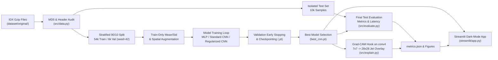

## Model Training & Configuration

All models were trained on CPU (`device="cpu"`) under identical optimization budgets configured in [`run_config.json`](run_config.json) and [`src/train.py`](src/train.py). `BaselineMLP` and `StandardCNN` trained without spatial augmentation, whereas `RegularizedCNN` enabled train-only random horizontal flipping and reflection-padded cropping. Note that [`src/models.py`](src/models.py) sets `RegularizedCNN` default `dropout_rate=0.25` for `Dropout2d` blocks and `0.4` for the classifier head (`Dropout(0.4)`).

| Parameter | Verified Value | Scope / Notes |
|---|---|---|
| **Loss Function** | `CrossEntropyLoss` | Multi-class categorical objective (`10` classes) |
| **Optimizer** | `Adam` | Initial `lr = 0.001`, `weight_decay = 1e-4` |
| **LR Scheduler** | `ReduceLROnPlateau` | `mode="min"`, `factor=0.5`, `patience=2` on validation loss |
| **Batch Size** | `128` | Configured in [`run_config.json`](run_config.json) |
| **Max Epochs** | `12` | Early stopping triggered when `val_loss` does not improve for `patience=3` epochs |
| **Random Seed** | `42` | Applied across Python `random`, `numpy`, and `torch` |
| **Compute Device** | `cpu` | PyTorch CPU execution (`torch==2.15.0+cpu`) |

```bash
python -m src.train --data-dir dataset/original --output-dir . --model all --epochs 12 --batch-size 128 --seed 42
```

## Model Comparison & Selection

Controlled experiments tracked across [`history_mlp.json`](history_mlp.json), [`history_standard_cnn.json`](history_standard_cnn.json), [`history_regularized_cnn.json`](history_regularized_cnn.json), and [`metrics.json`](metrics.json) demonstrate consistent validation and test gains as spatial convolution and regularization are introduced. `StandardCNN` triggered early stopping at epoch `9` (best epoch `6`) due to validation loss oscillation after epoch `6`, whereas `RegularizedCNN` converged smoothly to epoch `11` without overfitting and was selected as [`models/best_cnn.pt`](models/best_cnn.pt).

| Model | Parameters | Augmentation | Best Epoch | Training Time | Best Val Loss | Best Val Accuracy | Test Accuracy | Test Macro F1 |
|---|---:|:---:|---:|---:|---:|---:|---:|---:|
| **MLP Baseline** | `235,146` | No | `9` / `12` | `38.63 s` | `0.2955` | `89.55%` | `88.73%` | `88.75%` |
| **Standard CNN** | `421,642` | No | `6` / `9` | `151.18 s` | `0.2118` | `91.88%` | `91.68%` | `91.68%` |
| **Regularized CNN (Selected)** | `871,082` | Yes | `11` / `12` | `528.44 s` | **`0.1842`** | **`93.27%`** | **`92.61%`** | **`92.58%`** |

## Model Artifacts & Checkpoints

All trained PyTorch checkpoints and experiment logs generated during the training and evaluation runs are preserved in the repository. Each `.pt` checkpoint stores `epoch`, `model_name`, `state_dict`, `val_loss`, `val_acc`, `param_count`, `train_mean`, `train_std`, `class_names`, `seed`, and `hyperparameters`.

| Artifact | Format | Purpose | Repository Path |
|---|---|---|---|
| **Best CNN Checkpoint** | PyTorch `.pt` | Selected `RegularizedCNN` weights (Epoch `11`) used for test evaluation, Grad-CAM, and Streamlit inference | [`models/best_cnn.pt`](models/best_cnn.pt) |
| **Regularized CNN Checkpoint** | PyTorch `.pt` | Best validation-loss checkpoint for `RegularizedCNN` | [`models/regularized_cnn.pt`](models/regularized_cnn.pt) |
| **Standard CNN Checkpoint** | PyTorch `.pt` | Best validation-loss checkpoint for `StandardCNN` (Epoch `6`) | [`models/standard_cnn.pt`](models/standard_cnn.pt) |
| **Baseline MLP Checkpoint** | PyTorch `.pt` | Best validation-loss checkpoint for `BaselineMLP` (Epoch `9`) | [`models/mlp.pt`](models/mlp.pt) |
| **Evaluation Metrics Log** | JSON | Full test metrics, per-class report, confusion matrix, model comparison, and CPU latency | [`metrics.json`](metrics.json) |
| **Training History Logs** | JSON | Per-epoch train/val loss, accuracy, and timing for each model | [`history_mlp.json`](history_mlp.json), [`history_standard_cnn.json`](history_standard_cnn.json), [`history_regularized_cnn.json`](history_regularized_cnn.json) |
| **Split & Run Metadata** | JSON | Stratified split indices (`54,000` / `6,000`) and CLI hyperparameters | [`split_indices.json`](split_indices.json), [`run_config.json`](run_config.json) |

## Model Evaluation & Results

Final evaluation of `RegularizedCNN` ([`models/best_cnn.pt`](models/best_cnn.pt)) on the isolated `10,000`-sample Fashion-MNIST test set in [`metrics.json`](metrics.json) achieved **92.61%** overall test accuracy (`9,261 / 10,000` correct) and **92.58%** macro F1-score, with single-image CPU latency averaging **0.71 ms** (`p50 = 0.63 ms`, `p95 = 1.09 ms`) and batched (`batch_size=64`) latency averaging **10.67 ms** per batch. *(Note: earlier benchmark copy inside `final_report.md` and `streamlit/app.py` displays `0.92 ms` single-item latency from an initial run, whereas the committed `metrics.json` records `0.71 ms`.)*

| Fashion Category | Support | Precision | Recall | F1-Score | Error Concentration |
|---|---:|---:|---:|---:|---|
| **Trouser** | `1,000` | `99.70%` | `98.80%` | `99.25%` | Minimal (`9` misclassified as `Dress`) |
| **Sandal** | `1,000` | `99.09%` | `98.00%` | `98.54%` | `14` misclassified as `Sneaker`, `6` as `Ankle boot` |
| **Bag** | `1,000` | `97.82%` | `98.90%` | `98.36%` | Scattered single-digit errors (`11` total) |
| **Ankle boot** | `1,000` | `98.05%` | `95.50%` | `96.76%` | `40` misclassified as `Sneaker` |
| **Sneaker** | `1,000` | `94.72%` | `98.60%` | `96.62%` | `11` misclassified as `Ankle boot` |
| **Dress** | `1,000` | `92.84%` | `93.40%` | `93.12%` | `24` as `Coat`, `22` as `Shirt` |
| **Pullover** | `1,000` | `88.92%` | `89.90%` | `89.41%` | `48` as `Shirt`, `32` as `Coat` |
| **Coat** | `1,000` | `87.33%` | `90.30%` | `88.79%` | `45` as `Shirt`, `35` as `Pullover` |
| **T-shirt/top** | `1,000` | `88.52%` | `87.10%` | `87.80%` | `86` misclassified as `Shirt` |
| **Shirt** | `1,000` | `78.83%` | `75.60%` | `77.18%` | `92` as `T-shirt/top`, `71` as `Coat`, `47` as `Pullover` |

- **Zero Cross-Domain Confusion:** The confusion matrix records `0` errors between structurally distinct categories such as `Trouser` vs. `Sneaker` or `Bag` vs. `Trouser`, confirming strong global silhouette discrimination.
- **Upper-Body Garment Ambiguity:** Out of `739` total test misclassifications, the top six confusion pairs all involve `Shirt` (`Shirt -> T-shirt/top`: `92`, `T-shirt/top -> Shirt`: `86`, `Shirt -> Coat`: `71`, `Pullover -> Shirt`: `48`, `Shirt -> Pullover`: `47`, `Coat -> Shirt`: `45`), reflecting collar/button detail loss at `28 x 28` resolution.
- **CPU Inference Throughput:** Measured across `100` warmup-stabilized single-image passes (`0.71 ms` mean, `0.20 ms` std) and `50` batched passes of `64` images (`10.67 ms` mean, `~0.17 ms` per image).

## Model Explainability & Interpretability

Visual explainability is implemented in [`src/explain.py`](src/explain.py) via `GradCAM`, targeting `RegularizedCNN.conv4` (`(64, 7, 7)` spatial feature maps). Gradients of the target class logit are backpropagated to `conv4`, aggregated via Global Average Pooling into channel importance weights, combined linearly with `ReLU` filtering, bilinearly upsampled to `28 x 28`, min-max normalized to `[0, 1]`, and blended onto the grayscale garment using a `jet` colormap (`alpha = 0.55`). Visual examples are shown in [Results Visualization & Preview](#5-fashion-mnist-sample-gallery--grad-cam-attribution-heatmaps) (`screenshots/image5.webp`) and [Grad-CAM Spatial Attention](#2-streamlit-tab-1--grad-cam-spatial-attention--10-class-probability-distribution) (`screenshots/image2.webp`).

| Component / Observation | Technical Detail |
|---|---|
| **Target Convolutional Layer** | `RegularizedCNN.conv4` (output shape `(B, 64, 7, 7)` prior to `MaxPool2d`) |
| **Attribution Formulation** | Channel-wise GAP of target logit gradients multiplied by forward activations, `ReLU`, bilinear upsampling to `(28, 28)` |
| **Correct Prediction Focus** | Concentrates on discriminative topology: dual trouser leg bifurcation, sandal strap openings, bag handles, and sneaker/boot heel-toe contours |
| **Misclassification Focus** | Diffuse or mid-torso activation on `Shirt` vs. `T-shirt/top` and `Coat` cases where low resolution obscures collars and seams |
| **Interpretability Limitation** | `7 x 7` pre-upsampling grid limits fine-grained localization, and gradient sensitivity reflects local correlation rather than causal reasoning |

## Results Visualization & Preview

### 1. Streamlit Tab 1 — Live Image Classification & Prediction Confidence
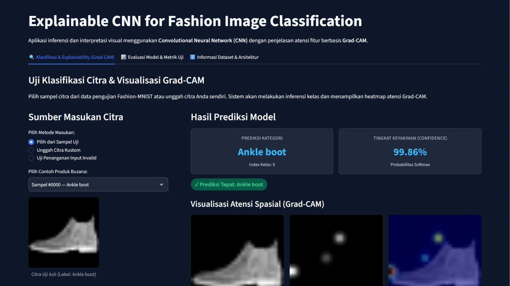
Interactive classification workspace inside the dark-mode Streamlit application displaying input source selection (`Pilih dari Sampel Uji`), the `28 x 28` test sample (`Sampel #0000 — Ankle boot`), predicted category card (`Ankle boot` at `99.86%` softmax confidence), and the Grad-CAM visualization header.

### 2. Streamlit Tab 1 — Grad-CAM Spatial Attention & 10-Class Probability Distribution
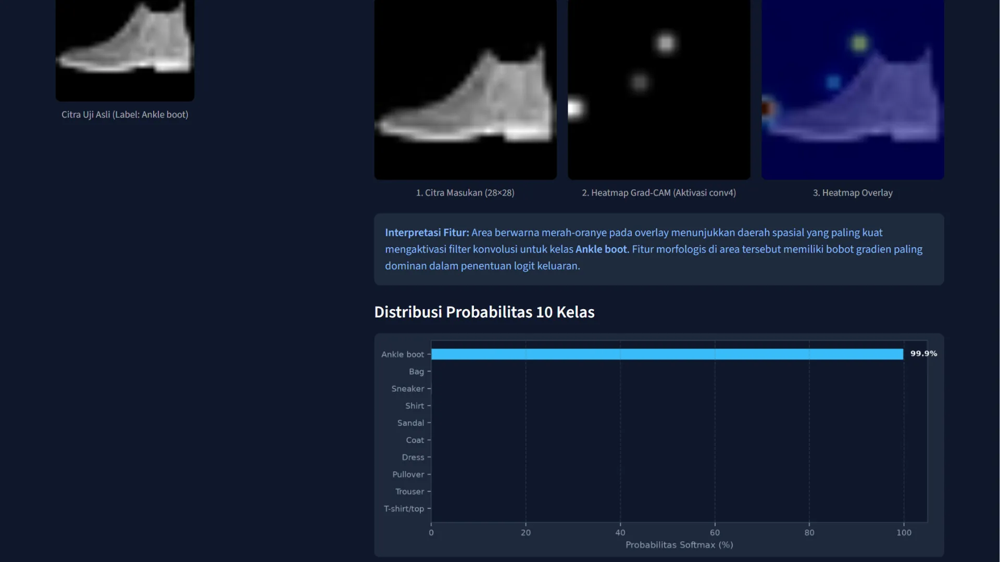
Lower half of Tab 1 displaying the three-panel Grad-CAM breakdown (`Input Image`, `conv4` activation heatmap, and `Heatmap Overlay`), a feature interpretation summary, and a horizontal bar chart showing `99.9%` softmax probability concentrated on `Ankle boot` across all `10` classes.

### 3. Streamlit Tab 2 — Model Evaluation Dashboard & KPI Summary
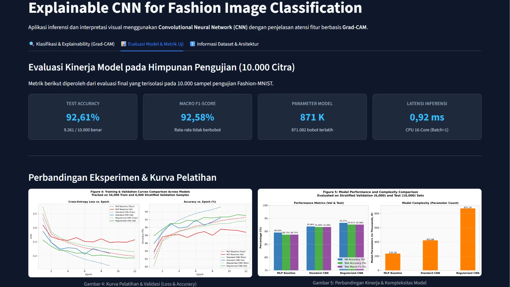
Evaluation dashboard presenting isolated test KPIs (`92.61%` Test Accuracy, `92.58%` Macro F1-Score, `871K` parameters) alongside side-by-side training convergence curves and multi-model accuracy/complexity comparison plots.

### 4. Streamlit Tab 3 — Dataset Specifications & Regularized CNN Architecture
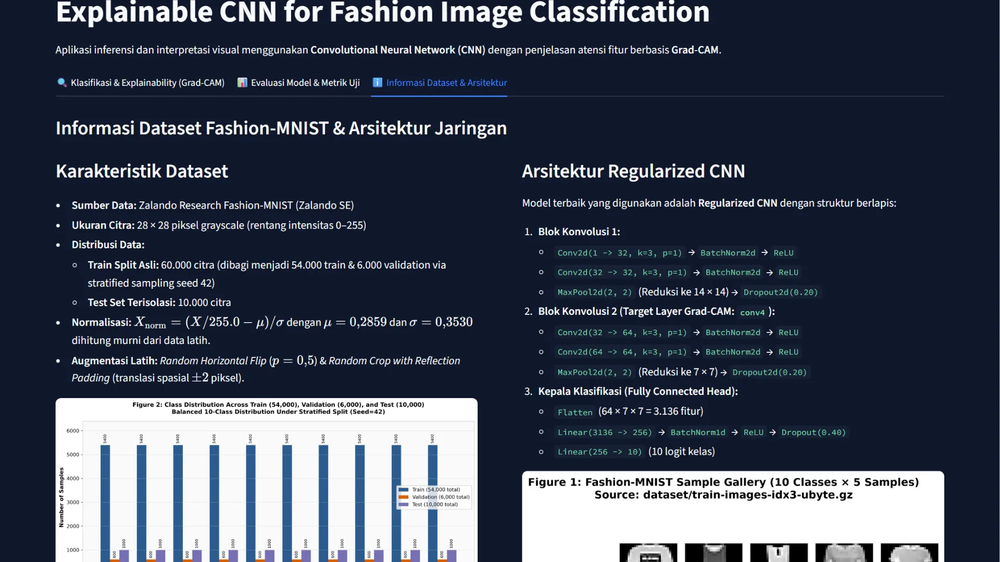
System documentation tab summarizing Zalando Fashion-MNIST provenance, train-only normalization statistics (`mean = 0.2859`, `std = 0.3530`), augmentation rules, balanced class distribution plot, and the layer-by-layer `RegularizedCNN` architecture targeting `conv4`.

### 5. Fashion-MNIST Sample Gallery & Grad-CAM Attribution Heatmaps
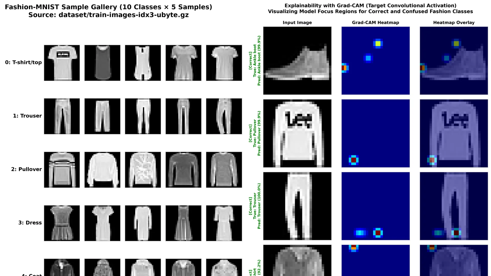
Combined preview pairing the Fashion-MNIST sample gallery (`10` classes x `5` examples on the left) with `GradCAM` attribution maps (right) illustrating `Input Image`, `Grad-CAM Heatmap`, and `Heatmap Overlay` on representative `Ankle boot`, `Pullover`, `Trouser`, and `Shirt` predictions.

### 6. Test Set Prediction Examples (Correct vs. Misclassified Pairs)
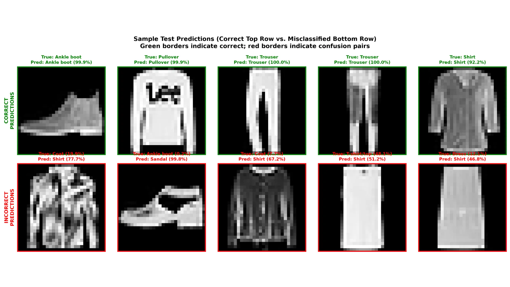
Qualitative test-set gallery contrasting five high-confidence correct predictions (`Ankle boot 99.9%`, `Pullover 99.9%`, `Trouser 100.0%`, `Shirt 92.2%`, green borders) in the top row with five misclassified samples in the bottom row (`Coat -> Shirt`, `T-shirt/top -> Shirt`, `Dress -> Shirt`, red borders).

### 7. Pixel Intensity Distribution & Class-Wise Mean Heatmaps
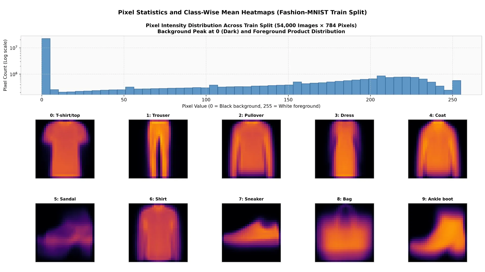
Exploratory analysis across the `54,000`-image training split showing a log-scale pixel intensity histogram dominated by the `0` black background peak, paired with `10` per-class mean intensity maps highlighting structural overlap among upper-body garments (`T-shirt/top`, `Pullover`, `Coat`, `Shirt`).

### 8. Training & Validation Loss and Accuracy Curves Across Architectures
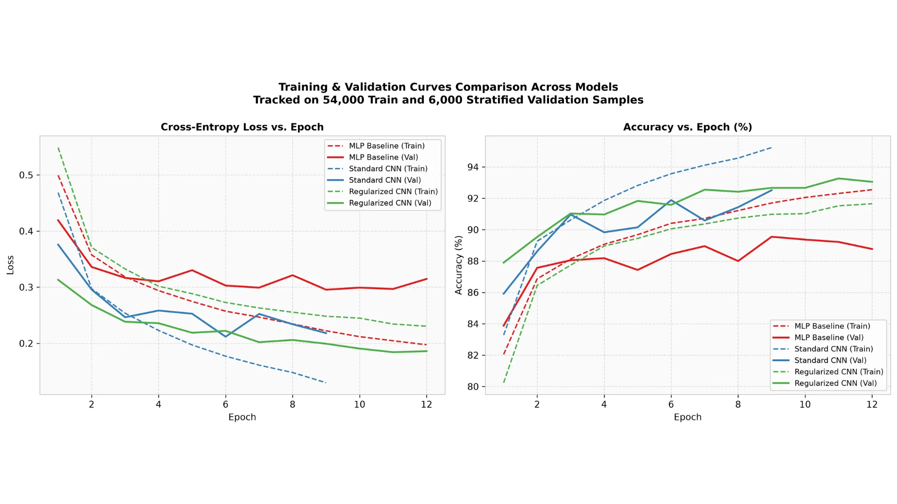
Epoch-by-epoch cross-entropy loss (left) and accuracy (right) curves comparing `MLP Baseline`, `Standard CNN`, and `Regularized CNN` on `54,000` training and `6,000` stratified validation samples, showing `Standard CNN` overfitting past epoch `6` while `Regularized CNN` smoothly reaches `0.1842` validation loss at epoch `11`.

### 9. Multi-Model Performance & Parameter Complexity Comparison
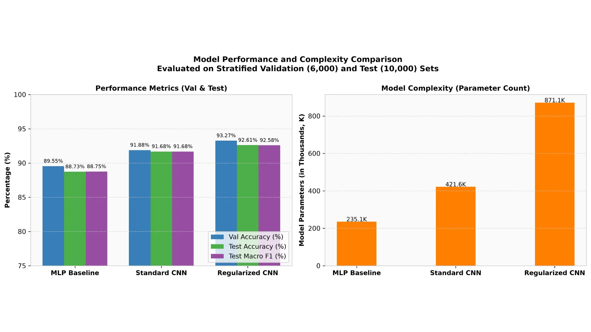
Side-by-side benchmark bar charts comparing Validation Accuracy, Test Accuracy, Test Macro F1 (left), and trainable parameter counts (`235.1K`, `421.6K`, `871.1K`, right), confirming that `Regularized CNN` delivers the strongest generalization (`92.61%` test accuracy, `92.58%` Macro F1).

### 10. Balanced Class Distribution Across Train, Validation, and Test Splits
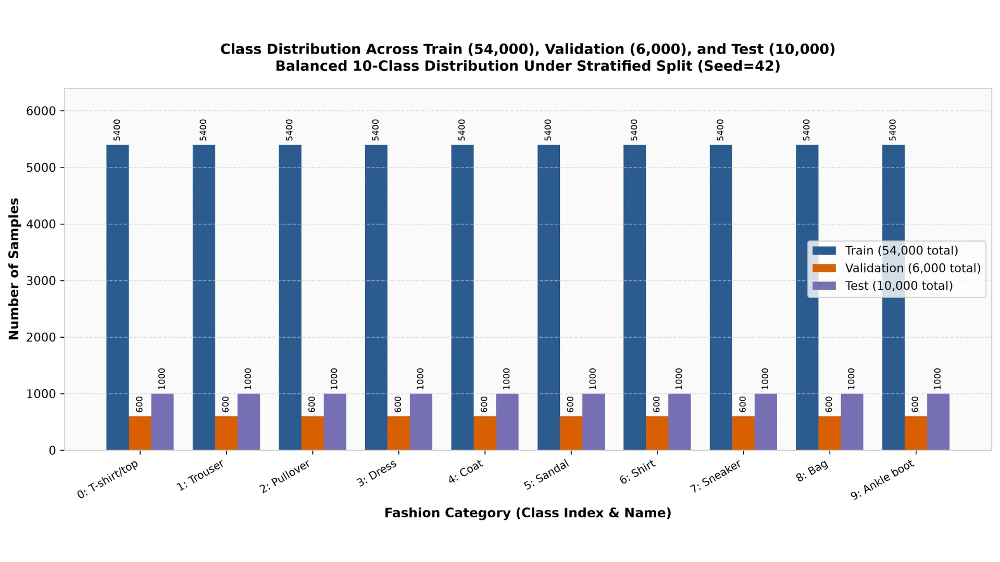
Grouped bar chart confirming perfectly balanced class representation across all `10` Fashion-MNIST categories (`5,400` train, `600` validation, and `1,000` test samples per class) generated via deterministic stratified splitting (`seed=42`).

### 11. Per-Class Test Precision, Recall, and F1-Score
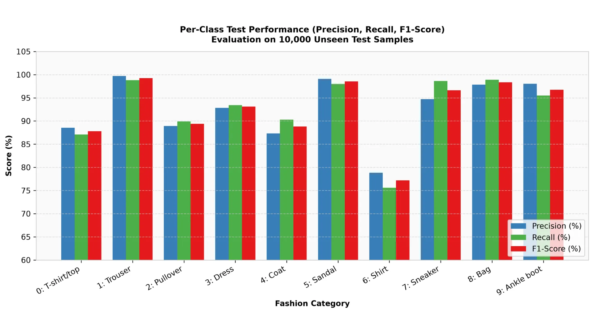
Per-class test evaluation across all `10,000` unseen samples showing near-perfect F1 scores on `Trouser` (`99.25%`), `Sandal` (`98.54%`), and `Bag` (`98.36%`), contrasted against the primary bottleneck on `Shirt` (`78.83%` precision, `75.60%` recall, `77.18%` F1).

### 12. Test Set Confusion Matrices (Raw Counts & Normalized Recall)
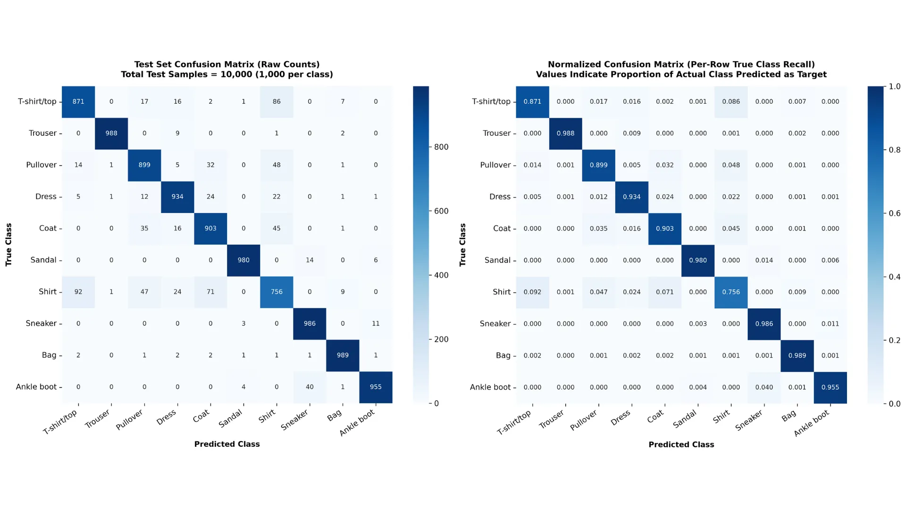
Raw sample count confusion matrix (left) and row-normalized recall confusion matrix (right) across `10,000` test samples, revealing strong diagonal accuracy, zero cross-domain errors, and symmetric confusion among `Shirt`, `T-shirt/top`, `Coat`, and `Pullover`.

## Prerequisites

- **Operating System:** Windows, Linux, or macOS (repository verified on CPU execution).
- **Python Runtime:** Python 3.x (experiment recorded on Python `3.15.1`).
- **Core Python Packages:** Listed in [`requirements.txt`](requirements.txt) (`torch==2.15.0+cpu`, `torchvision==0.29.2+cpu`, `numpy==2.5.4`, `scikit-learn==1.9.1`, `matplotlib==3.11.2`, `seaborn==0.13.2`, `Pillow==13.0.0`, `pytest==9.2.0`, `streamlit==1.67.0`).
- **Compute Hardware:** Standard multi-core CPU is sufficient for both training (`~12` minutes total across all 3 models on 16-core CPU) and sub-millisecond inference; CUDA GPU is optional (`src/train.py` defaults to CUDA if available, otherwise CPU).
- **Local Dataset Files:** The four official Zalando Fashion-MNIST `.gz` files are already present in [`dataset/original/`](dataset/original).

## Installation & Setup

1. Clone the repository and navigate to the project root:
   ```bash
   git clone https://github.com/weztcy/Explainable-CNN-for-Fashion-Image-Classification.git
   cd "Explainable CNN for Fashion Image Classification"
   ```
2. Create and activate an isolated Python virtual environment:
   ```bash
   python -m venv .venv
   # Windows PowerShell:
   .venv\Scripts\Activate.ps1
   # Linux/macOS:
   source .venv/bin/activate
   ```
3. Install pinned dependencies from [`requirements.txt`](requirements.txt):
   ```bash
   pip install --upgrade pip
   pip install -r requirements.txt
   ```
4. Verify dataset checksums, model forward/backward passes, and Grad-CAM execution using `pytest`:
   ```bash
   python -m pytest -v
   ```
   *(Note: [`tests/test_data.py`](tests/test_data.py) expects `--data-dir` `"dataset"` by default; if running tests directly against this repository layout where `.gz` files reside in [`dataset/original/`](dataset/original), ensure the four `.gz` files are accessible under `dataset/` or pass the corresponding directory.)*

## Usage & Execution

You can inspect the pre-trained model via the Streamlit dashboard or run training, test evaluation, and Grad-CAM figure generation from the CLI. Note that [`src/train.py`](src/train.py), [`src/evaluate.py`](src/evaluate.py), [`src/explain.py`](src/explain.py), and [`streamlit/app.py`](streamlit/app.py) default `--data-dir` to `dataset` and `--output-dir` to `outputs`; in this repository layout, raw `.gz` files are located in [`dataset/original/`](dataset/original) and trained checkpoints/metrics are stored in [`models/`](models) and the project root.

1. **Train All Three Architectures (`BaselineMLP`, `StandardCNN`, `RegularizedCNN`):**
   ```bash
   python -m src.train --data-dir dataset/original --output-dir outputs --model all --epochs 12 --batch-size 128 --seed 42
   ```
2. **Evaluate Checkpoints on the Isolated Test Set & Measure Latency:**
   ```bash
   python -m src.evaluate --data-dir dataset/original --output-dir outputs --checkpoint outputs/models/best_cnn.pt
   ```
   To evaluate the pre-trained checkpoint included in this repository directly, pass `--checkpoint models/best_cnn.pt`.
3. **Generate Grad-CAM Attribution Heatmaps (`10_explainability_heatmaps.png`):**
   ```bash
   python -m src.explain --data-dir dataset/original --output-dir outputs --checkpoint models/best_cnn.pt
   ```
4. **Launch the Dark-Mode Streamlit Web Application:**
   *(Ensure `outputs/models/best_cnn.pt` and `outputs/metrics.json` are aligned with [`models/best_cnn.pt`](models/best_cnn.pt) and [`metrics.json`](metrics.json) or run from a directory containing `outputs/`.)*
   ```bash
   streamlit run streamlit/app.py --server.port 8501 --server.headless true
   ```
   Then open `http://localhost:8501` in a browser to test sample or custom image inference, inspect 10-class softmax probabilities, and view live Grad-CAM overlays.

## Reproducibility & Execution

The experiment pipeline enforces deterministic behavior through fixed seeding (`seed=42` across `random`, `numpy`, and `torch`), persisted split indices ([`split_indices.json`](split_indices.json)), recorded CLI parameters ([`run_config.json`](run_config.json)), and pinned package versions ([`requirements.txt`](requirements.txt)).

1. **Deterministic Data Partitioning:** [`get_stratified_split()`](src/data.py#L192-L219) shuffles class indices with `np.random.default_rng(42)` to produce exact `5,400` train and `600` validation samples per class, saved to [`split_indices.json`](split_indices.json).
2. **Reproducible Training Loop:** [`set_seed(42)`](src/train.py#L21-L29) initializes `random`, `numpy`, and `torch` generators alongside a seeded `torch.Generator()` for training `DataLoader` shuffling.
3. **End-to-End Verification Sequence:**
   ```bash
   python -m src.train --data-dir dataset/original --output-dir outputs --model all --epochs 12 --batch-size 128 --seed 42
   python -m src.evaluate --data-dir dataset/original --output-dir outputs --checkpoint outputs/models/best_cnn.pt
   python -m src.explain --data-dir dataset/original --output-dir outputs --checkpoint outputs/models/best_cnn.pt
   ```
4. **Reproducibility Scope & Limitations:** Re-running `src.evaluate` and `src.explain` against [`models/best_cnn.pt`](models/best_cnn.pt) reproduces test predictions and Grad-CAM heatmaps deterministically on CPU, whereas wall-clock latency measurements (`mean_ms`, `p50_ms`, `p95_ms`) depend on host CPU load and core count. If run on CUDA hardware, minor floating-point variations across cuDNN kernels may occur.

## Contributing

Contributions to extend model architectures, add comparative explainability methods (such as Integrated Gradients or Score-CAM), or enhance diagnostic visualizations are welcome through a standard pull-request workflow:

1. Fork the repository.
2. Create a feature branch for your change (`git checkout -b feature/your-feature`).
3. Make the changes while preserving existing code style and documentation.
4. Run relevant checks or tests (`python -m pytest -v`) when available.
5. Commit and push the branch to your fork.
6. Open a pull request with a clear explanation of the modification and verification results.

## License

This project is licensed under the MIT License.
See the [LICENSE](LICENSE) file for details.

## Author & Contact

**Yohanes Dimas Pratama**

- GitHub: [github.com/weztcy](https://github.com/weztcy)
- Portfolio: [yohanesdimas.com](https://yohanesdimas.com)
- LinkedIn: [linkedin.com/in/yohanes-dimas](https://www.linkedin.com/in/yohanes-dimas)
