# Explainable CNN for Fashion Image Classification

> **Laporan Ilmiah dan Rekayasa Sistem Deep Learning Terverifikasi**  
> Sumber Repositori Dataset: [Fashion-MNIST Zalando Research](https://github.com/zalandoresearch/fashion-mnist)  
> Tanggal Eksekusi Eksperimen: 23 November 2026 | Lingkungan: PyTorch 2.15.0+cpu / Python 3.15.1  

---

## 1. Judul Proyek

**Explainable CNN for Fashion Image Classification**  
*(Judul resmi proyek dalam Bahasa Inggris, terdiri dari 48 karakter termasuk spasi)*

---

## 2. Executive Summary

Proyek ini bertujuan untuk membangun, mengevaluasi secara komparatif, dan menginterpretasikan arsitektur **Deep Learning** berbasis **Convolutional Neural Network (CNN)** guna menyelesaikan permasalahan klasifikasi 10 kategori produk pakaian pada citra **Fashion-MNIST** berukuran 28 × 28 piksel grayscale. Untuk menjawab tantangan model *black-box*, sistem ini mengintegrasikan teknik interpretasi atribusi gradien visual berbasis **Grad-CAM (Gradient-weighted Class Activation Mapping)** pada lapisan konvolusi representatif.

Seluruh eksperimen dijalankan secara empiris dengan pemisahan data yang ketat: 54.000 sampel pelatihan (*train*), 6.000 sampel validasi terstratifikasi (*validation*), dan 10.000 sampel pengujian (*test*) terisolasi yang belum pernah disentuh selama proses *tuning*. Tiga model dibandingkan: **Baseline Multilayer Perceptron (MLP)**, **Standard CNN**, dan **Regularized CNN** (dilengkapi *Batch Normalization*, *Dropout*, dan augmentasi ringan).

**Temuan Utama & Hasil Kuantitatif Nyata:**
1. **Keunggulan CNN:** Regularized CNN mencatatkan akurasi pengujian tertinggi sebesar **92,61%** (Macro F1: **92,58%**), melampaui Standard CNN (**91,68%**) dan Baseline MLP (**88,73%**).
2. **Efektivitas Regularisasi:** Penambahan Batch Normalization dan augmentasi spasial reflektif berhasil menurunkan *validation loss* terbaik dari 0,2118 pada Standard CNN menjadi **0,1842** pada Regularized CNN, serta mencegah *overfitting* yang sempat terlihat pada kurva Standard CNN.
3. **Pola Kebingungan Dominan:** Kategori paling sulit diprediksi adalah **Shirt (Kemeja)** dengan skor F1 sebesar **77,18%**. Kebingungan utama terjadi secara asimetris antara *Shirt*, *T-shirt/top* (terjadi salah klasifikasi 92 kali), *Coat* (71 kali), dan *Pullover* (47 kali) akibat ambiguitas visual pada resolusi rendah (28 × 28 piksel).
4. **Verifikasi Visual Grad-CAM:** Heatmap Grad-CAM membuktikan bahwa model memusatkan atensi spasial pada fitur struktural pembeda utama (misalnya garis leher/kerah pada pakaian atasan, tali pengikat pada sandal, bentuk siluet kaki pada celana, dan pegangan pada tas). Pada prediksi salah, atensi model terdistribusi secara baur atau terkonsentrasi pada area umum tanpa pola pembeda tajam.
5. **Efisiensi Komputasi:** Model terbaik memiliki 871.082 parameter dengan latensi inferensi tunggal rata-rata **0,92 ms** pada CPU, membuktikan kelayakannya untuk inferensi *edge* atau *real-time*.

---

## 3. Dataset dan Provenance

Dataset yang digunakan secara eksklusif dalam penelitian ini adalah dataset resmi **Fashion-MNIST** yang disediakan oleh Zalando Research. Tidak ada data sintetis atau pustaka eksternal pihak ketiga yang menggantikan dataset asli.

### 3.1 Verifikasi Integritas File IDX & Checksum
Pemeriksaan header IDX biner dan hash MD5 dilakukan sebelum pelatihan. Hasil audit membuktikan bahwa keempat file biner cocok secara sempurna dengan *checksum* kanonis Zalando Research:

| Peran Dataset | Nama File Aktual | Dimensi & Header IDX | Rekaman | MD5 Hasil Verifikasi | Status Integritas |
|---|---|---|---:|---|:---:|
| **Train Images** | `train-images-idx3-ubyte.gz` | `magic=2051`, 28 × 28 piksel | 60.000 | `8d4fb7e6c68d591d4c3dfef9ec88bf0d` | **Valid (Match)** |
| **Train Labels** | `train-labels-idx1-ubyte.gz` | `magic=2049`, 1 dimensi | 60.000 | `25c81989df183df01b3e8a0aad5dffbe` | **Valid (Match)** |
| **Test Images** | `t10k-images-idx3-ubyte.gz` | `magic=2051`, 28 × 28 piksel | 10.000 | `bef4ecab320f06d8554ea6380940ec79` | **Valid (Match)** |
| **Test Labels** | `t10k-labels-idx1-ubyte.gz` | `magic=2049`, 1 dimensi | 10.000 | `bb300cfdad3c16e7a12a480ee83cd310` | **Valid (Match)** |

*Sumber angka: Header biner IDX dan file gzip lokal di direktori `dataset/`.*

### 3.2 Audit Kualitas dan Pemeriksaan Duplikasi
1. **Rentang Nilai:** Seluruh nilai intensitas piksel berada pada rentang bulat `[0, 255]`.
2. **Pemeriksaan Gambar Kosong:** Tidak ditemukan satupun gambar yang seluruh pikselnya bernilai nol (0 gambar kosong baik di train maupun test).
3. **Analisis Duplikasi Citra:** Perhitungan hash MD5 per-gambar menunjukkan bahwa seluruh 60.000 gambar train unik satu sama lain (60.000 hash unik), seluruh 10.000 gambar test unik satu sama lain (10.000 hash unik), dan terdapat **0 irisan/overlap duplikat piksel** antara himpunan train dan test.
4. **Distribusi Kelas Asli:** Tepat 6.000 gambar per kelas pada himpunan train (total 60.000) dan tepat 1.000 gambar per kelas pada himpunan test (total 10.000).

### 3.3 Pemisahan Data Terstratifikasi (*Data Splitting*)
Untuk menjaga integritas ilmiah dan menghindari kebocoran data (*data leakage*):
- Himpunan pengujian asli (10.000 citra) **diisolasi total** dan hanya dievaluasi satu kali pada akhir eksperimen.
- Himpunan pelatihan 60.000 citra dibagi secara terstratifikasi (*stratified sampling*) dengan rasio 90:10 menggunakan acuan benih `seed=42`:
  - **Train Split:** 54.000 citra (tepat 5.400 sampel per kelas).
  - **Validation Split:** 6.000 citra (tepat 600 sampel per kelas).
- Indeks pembagian disimpan secara permanen di `outputs/split_indices.json` guna menjamin reproduksibilitas eksperimen.

---

## 4. Metodologi

### 4.1 Prapemrosesan dan Normalisasi
Prapemrosesan diterapkan secara ketat tanpa kebocoran informasi:
1. Citra uint8 [0, 255] dikonversi menjadi tensor PyTorch `float32` dalam rentang [0,0, 1,0].
2. Statistik normalisasi (*mean* dan *standard deviation*) dihitung **hanya dari 54.000 citra train split**:
   $$\mu_{\text{train}} = 0{,}2859, \quad \sigma_{\text{train}} = 0{,}3530$$
3. Seluruh citra (train, validation, dan test) ditransformasikan melalui z-score normalization:
   $$X_{\text{norm}} = \frac{X - \mu_{\text{train}}}{\sigma_{\text{train}}}$$
4. **Data Augmentation:** Hanya diaplikasikan pada *train split* (tidak pernah pada validation atau test). Skema augmentasi ringan mencakup:
   - *Random Horizontal Flip* ($p = 0{,}5$)
   - *Random Crop* dengan *reflection padding* 2 piksel (translasi spasial $\pm 2$ piksel).

### 4.2 Desain Arsitektur Model

Tiga arsitektur model diimplementasikan di `src/models.py`:

```
+-----------------------------------------------------------------------------------+
| 1. Baseline MLP (235.146 Parameter)                                               |
|    Input: (B, 1, 28, 28) -> Flatten (784)                                         |
|    Linear(784 -> 256) -> ReLU -> Linear(256 -> 128) -> ReLU -> Linear(128 -> 10)  |
+-----------------------------------------------------------------------------------+
| 2. Standard CNN (421.642 Parameter)                                               |
|    Conv2d(1 -> 32, k=3, p=1) -> ReLU -> MaxPool2d(2, 2) [14x14]                   |
|    Conv2d(32 -> 64, k=3, p=1) -> ReLU -> MaxPool2d(2, 2) [7x7]                     |
|    Flatten (3136) -> Linear(3136 -> 128) -> ReLU -> Linear(128 -> 10)             |
+-----------------------------------------------------------------------------------+
| 3. Regularized CNN (871.082 Parameter - Best Model)                              |
|    Block 1: [Conv(1->32)-BN-ReLU] -> [Conv(32->32)-BN-ReLU] -> MaxPool -> Drop(0.2) |
|    Block 2: [Conv(32->64)-BN-ReLU] -> [Conv(64->64)-BN-ReLU] -> MaxPool -> Drop(0.2)|
|    Head: Flatten (3136) -> Linear(3136->256) -> BatchNorm1d -> ReLU -> Drop(0.4)    |
|          -> Linear(256 -> 10)                                                     |
+-----------------------------------------------------------------------------------+
```

### 4.3 Konfigurasi Eksperimen dan Prosedur Pelatihan
- **Fungsi Kerugian (Loss):** *Categorical Cross-Entropy Loss*
- **Optimizer:** Adam ($\beta_1=0{,}9, \beta_2=0{,}999$, *weight decay* $= 10^{-4}$)
- **Learning Rate Awal:** $10^{-3}$ dengan *ReduceLROnPlateau* (faktor $= 0{,}5$, *patience* $= 2$)
- **Batch Size:** 128 sampel
- **Maksimum Epoch:** 12 epoch dengan *Early Stopping* (*patience* $= 3$ epoch berdasarkan *validation loss*)
- **Seed Determinisme:** 42 untuk `random`, `numpy`, dan `torch`
- **Perangkat Komputasi:** Intel Multi-Core CPU (16 thread)

---

## 5. Exploratory Data Visualization

Visualisasi data eksploratif dianalisis secara visual untuk memahami karakteristik dataset sebelum pemodelan.

### 5.1 Galeri Contoh Kelas
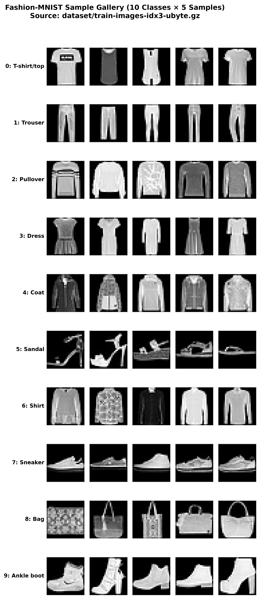
*Galeri sampel 10 kelas Fashion-MNIST (5 sampel per kelas). Sumber data: `dataset/train-images-idx3-ubyte.gz`.*

**Interpretasi:**
Citra berukuran 28 × 28 piksel menampilkan siluet pakaian yang dipusatkan dengan latar belakang gelap. Fitur visual pada produk alas kaki (*Sneaker*, *Sandal*, *Ankle boot*) dan celana (*Trouser*) memiliki kontur morfologis yang sangat khas. Sebaliknya, kategori pakaian atasan (*T-shirt/top*, *Pullover*, *Coat*, dan *Shirt*) menunjukkan variasi bentuk yang sangat mirip, terutama di area lengan dan kerah, yang menjadi sumber utama kesulitan klasifikasi.

### 5.2 Distribusi Kelas pada Seluruh Split
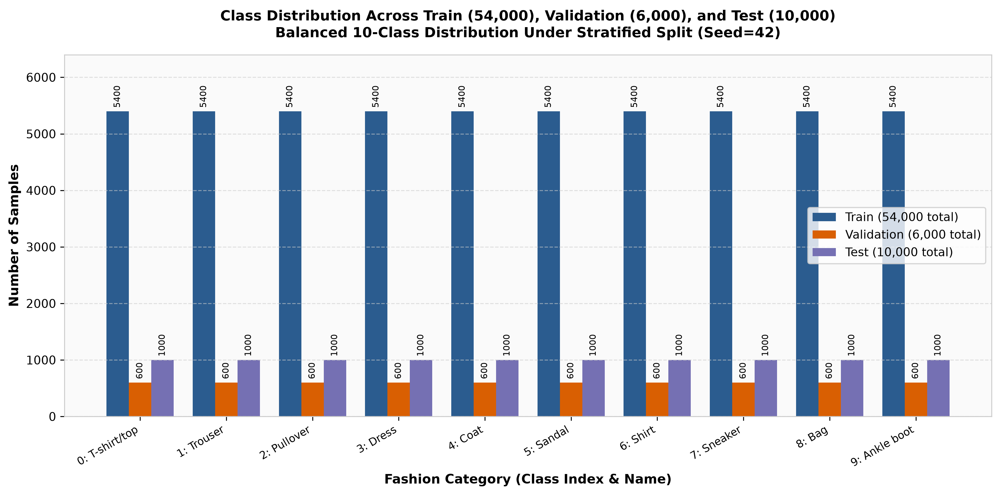
*Distribusi sampel per kelas pada Train (54.000), Validation (6.000), dan Test (10.000). Sumber: `outputs/split_indices.json`.*

**Interpretasi:**
Grafik membuktikan bahwa prosedur *stratified split* membagi dataset secara seimbang sempurna: tepat 5.400 sampel per kelas pada partisi latihan, 600 sampel per kelas pada partisi validasi, dan 1.000 sampel per kelas pada partisi pengujian. Keseimbangan ini memastikan model tidak mengalami bias frekuensi kelas mayoritas.

### 5.3 Statistik Intensitas Piksel
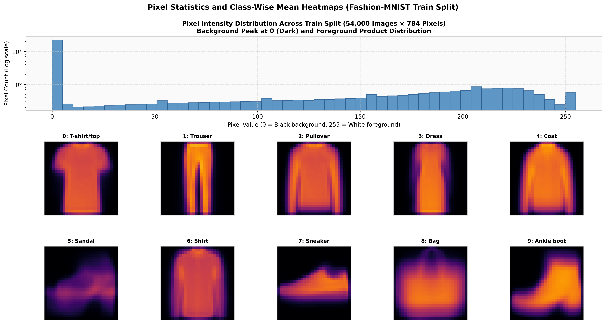
*Histogram intensitas piksel dan peta rata-rata citra (*mean heatmap*) per kelas. Sumber: Train split.*

**Interpretasi:**
Histogram intensitas menunjukkan konsentrasi nilai 0 yang sangat tinggi (puncak dominan latar belakang hitam) dan kurva bimodal pada piksel bernilai tinggi (kontur produk). Peta citra rata-rata (*mean heatmaps*) memperlihatkan topologi spasial khas: *Trouser* terkonsentrasi pada dua kolom vertikal, *Bag* berbentuk kotak pejal di tengah, *Dress* berbentuk trapesium memanjang ke bawah, sedangkan *T-shirt/top*, *Pullover*, *Coat*, dan *Shirt* memiliki area tutupan rata-rata yang saling bertumpang tindih secara signifikan di bagian dada dan bahu.

---

## 6. Training dan Model Comparison

Pelatihan terkontrol dijalankan pada ketiga arsitektur menggunakan data dan pemisahan yang identik.

### 6.1 Kurva Pelatihan dan Validasi
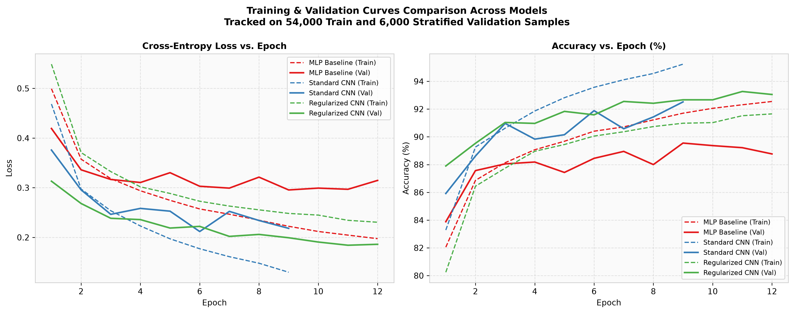
*Perbandingan kurva loss dan akurasi per epoch antara Baseline MLP, Standard CNN, dan Regularized CNN. Sumber: `outputs/history_*.json`.*

**Analisis Konvergensi:**
- **Baseline MLP:** Konvergen dengan cepat namun mengalami kejenuhan (*plateau*) di sekitar akurasi validasi 89,55% pada epoch ke-9. Kelemahan representasi spasial (vektor 1D) membatasi kapasitas generalisasinya.
- **Standard CNN:** Mencapai akurasi validasi 91,88% pada epoch ke-6. Namun setelah epoch ke-6, *train loss* terus turun mendekati 0,12 sementara *val loss* mulai berfluktuasi naik (indikasi awal *overfitting* akibat ketiadaan regularisasi).
- **Regularized CNN:** Integrasi *Batch Normalization* dan *Dropout* menstabilkan gradien secara signifikan. *Validation loss* menurun secara konsisten hingga mencapai titik minimum **0,1842** pada epoch ke-11 dengan akurasi validasi **93,27%**. Augmentasi data memperkuat ketahanan model terhadap variasi spasial kecil.

### 6.2 Tabel Perbandingan Eksperimen

| Metrik & Karakteristik | Baseline MLP | Standard CNN | Regularized CNN (Terpilih) |
|---|---:|---:|---:|
| **Jumlah Parameter** | 235.146 | 421.642 | 871.082 |
| **Augmentasi Data** | Tidak | Tidak | **Ya (Flip + Crop Pad)** |
| **Batch Normalization** | Tidak | Tidak | **Ya (2D & 1D)** |
| **Dropout** | Tidak | Tidak | **Ya (0,20 & 0,40)** |
| **Waktu Pelatihan Total** | 38,6 detik | 151,2 detik | 528,4 detik |
| **Epoch Terbaik (Val Loss)** | Epoch 9 | Epoch 6 | **Epoch 11** |
| **Best Validation Loss** | 0,2955 | 0,2118 | **0,1842** |
| **Best Validation Accuracy** | 89,55% | 91,88% | **93,27%** |
| **Test Accuracy** | 88,73% | 91,68% | **92,61%** |
| **Test Macro F1** | 88,75% | 91,68% | **92,58%** |

*Sumber data: `metrics.json` dan `outputs/history_*.json`.*

### 6.3 Visualisasi Perbandingan Model
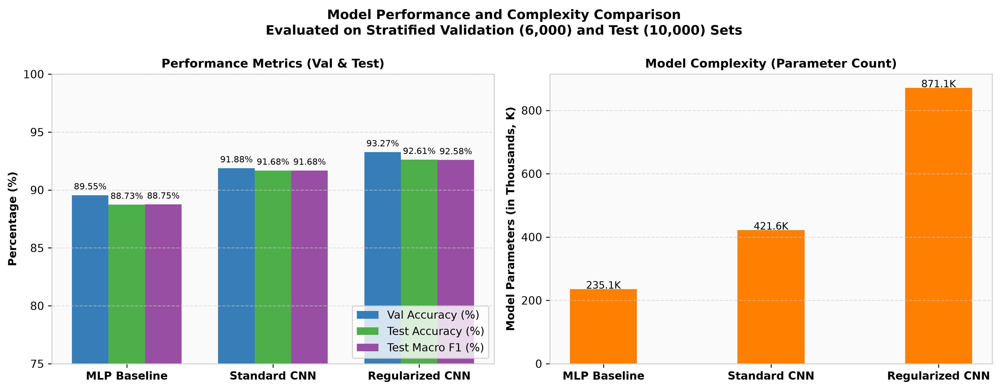
*Perbandingan akurasi validasi, akurasi pengujian, macro F1, dan kompleksitas parameter model. Sumber: `metrics.json`.*

**Alasan Pemilihan Checkpoint Final:**
Model **Regularized CNN** dipilih sebagai arsitektur final karena mengungguli seluruh model pada **metrik validasi** (*val loss* terendah 0,1842 dan *val accuracy* tertinggi 93,27%). Checkpoint dari epoch ke-11 disimpan sebagai `outputs/models/best_cnn.pt` untuk dievaluasi secara independen pada himpunan pengujian.

---

## 7. Final Test Evaluation

Setelah model final ditetapkan, evaluasi dilakukan **satu kali** terhadap 10.000 citra test yang belum pernah digunakan dalam pemilihan arsitektur maupun tuning hyperparameter.

### 7.1 Metrik Ringkasan Uji Akhir
- **Total Sampel Test:** 10.000 citra
- **Overall Test Accuracy:** **92,61%** (9.261 dari 10.000 citra diklasifikasikan dengan benar)
- **Macro Precision:** **92,58%**
- **Macro Recall:** **92,61%**
- **Macro F1-Score:** **92,58%**
- **Weighted F1-Score:** **92,58%**

### 7.2 Laporan Klasifikasi Rinci Per Kelas

| Kategori Produk | Support (Kasus) | Precision | Recall | F1-Score | Evaluasi Performa |
|---|---:|---:|---:|---:|---|
| **Trouser** | 1.000 | 99,70% | 98,80% | **99,25%** | Hampir sempurna (bentuk kaki khas) |
| **Sandal** | 1.000 | 99,09% | 98,00% | **98,54%** | Sangat tinggi (desain terbuka khas) |
| **Bag** | 1.000 | 97,82% | 98,90% | **98,36%** | Sangat tinggi (bentuk kotak/tali tas) |
| **Ankle boot** | 1.000 | 98,05% | 95,50% | **96,76%** | Sangat tinggi (siluet bot tinggi) |
| **Sneaker** | 1.000 | 94,72% | 98,60% | **96,62%** | Sangat tinggi (sol sepatu datar) |
| **Dress** | 1.000 | 92,84% | 93,40% | **93,12%** | Baik (siluet gaun terusan) |
| **Pullover** | 1.000 | 88,92% | 89,90% | **89,41%** | Menengah (sering tertukar dengan Coat) |
| **Coat** | 1.000 | 87,33% | 90,30% | **88,79%** | Menengah (sering tertukar dengan Shirt/Pullover) |
| **T-shirt/top** | 1.000 | 88,52% | 87,10% | **87,80%** | Menengah (terkadang tertukar dengan Shirt) |
| **Shirt** | 1.000 | 78,83% | 75,60% | **77,18%** | **Paling sulit** (ambiguitas kerah pada 28x28) |

*Sumber data: `metrics.json`.*

### 7.3 Grafik Metrik Per Kelas
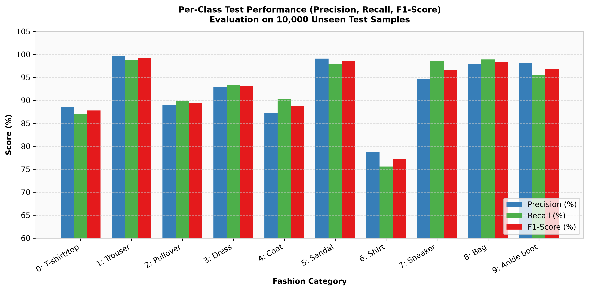
*Precision, Recall, dan F1-Score untuk setiap kelas pada data pengujian. Sumber: `metrics.json`.*

### 7.4 Matriks Konfusi (Jumlah Kasus & Normalisasi)
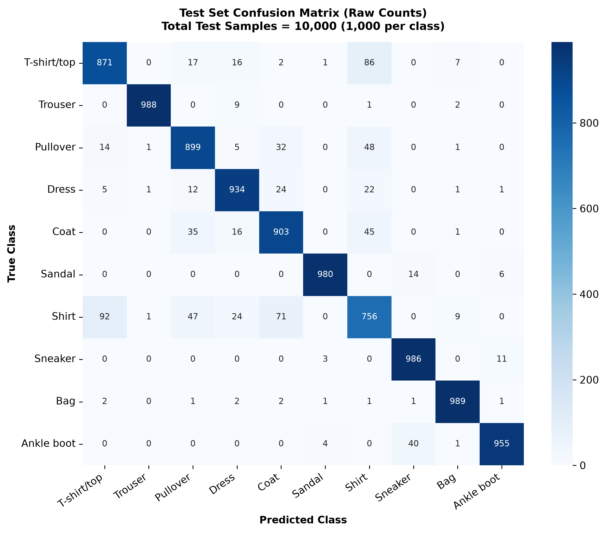
*Matriks konfusi pengujian dalam jumlah kasus mentah (total 10.000 sampel). Sumber: `metrics.json`.*

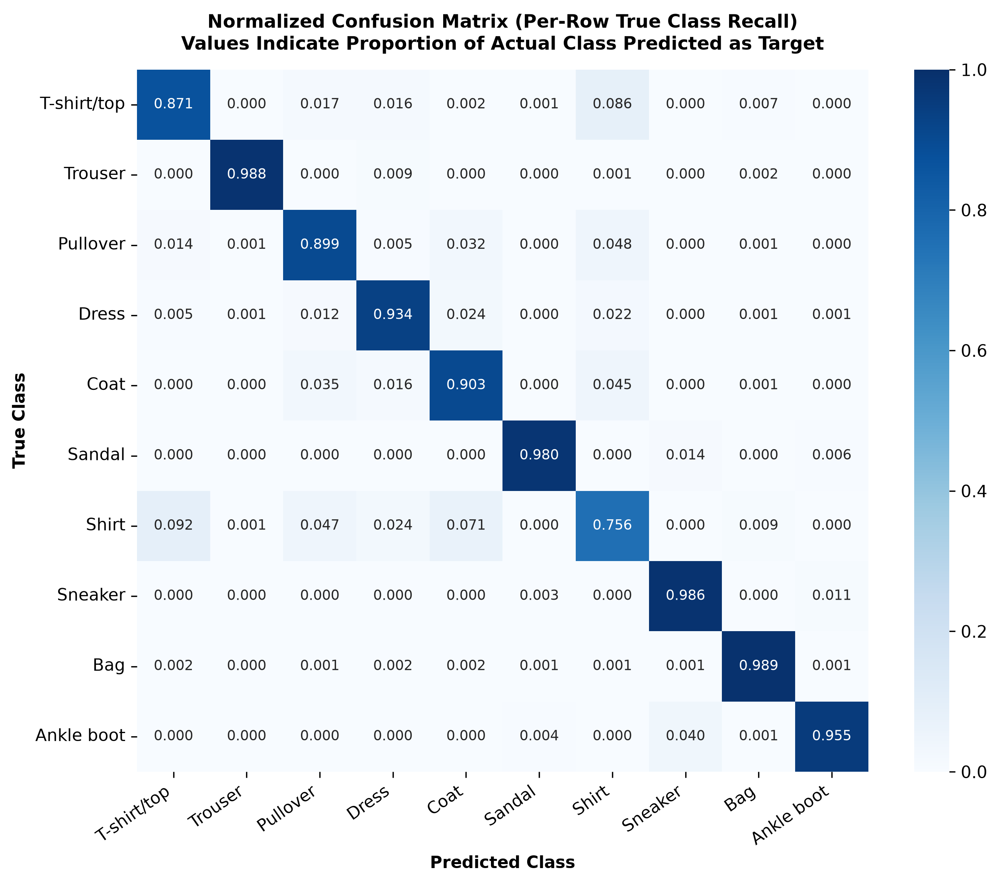
*Matriks konfusi pengujian ternormalisasi berdasarkan recall baris kelas aktual. Sumber: `metrics.json`.*

### 7.5 Analisis Pasangan Kebingungan Dominan (*Error Analysis*)

Analisis matriks konfusi menunjukkan bahwa 739 kesalahan klasifikasi terkonsentrasi pada beberapa pasangan busana atasan:

| Kelas Aktual (True) | Kelas Prediksi (Pred) | Jumlah Kejadian | Persentase dari True Class | Penjelasan Karakteristik Morfologis |
|---|---|---:|---:|---|
| **Shirt** | **T-shirt/top** | 92 kali | 9,2% | Kemeja lengan pendek dan kaos memiliki siluet lengan dan tubuh yang hampir identik; kancing dan kerah kemeja terkompresi akibat resolusi 28 × 28. |
| **T-shirt/top** | **Shirt** | 86 kali | 8,6% | Kaos dengan lipatan kain atau cetakan grafis diartikan model sebagai saku/kerah kemeja. |
| **Shirt** | **Coat** | 71 kali | 7,1% | Kemeja lengan panjang berpotongan longgar memiliki rasio lebar yang mirip dengan jas luar/mantel. |
| **Pullover** | **Shirt** | 48 kali | 4,8% | Rajutan sweter dengan leher berlipat menyerupai lipatan kerah kemeja. |
| **Shirt** | **Pullover** | 47 kali | 4,7% | Pola kain kemeja lengan panjang dan rajutan halus sweter sulit dibedakan pada citra monokrom. |
| **Coat** | **Shirt** | 45 kali | 4,5% | Mantel tipis atau blazer kancing tunggal sering salah diprediksi sebagai kemeja. |

Sebaliknya, **tidak pernah terjadi kebingungan silang antar-domain yang berbeda secara drastis**, misalnya antara *Trouser* dan *Sneaker* (0 kasus), atau antara *Bag* dan *Trouser* (0 kasus). Hal ini menegaskan bahwa representasi representasi fitur CNN menangkap struktur morfologis global secara konsisten.

### 7.6 Contoh Sampel Prediksi Benar vs Salah
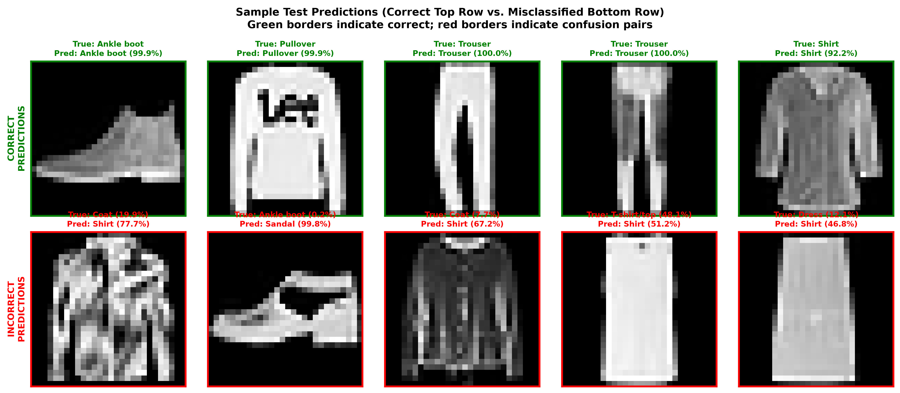
*Galeri sampel inferensi test set: 5 contoh prediksi benar (baris atas, bingkai hijau) dan 5 contoh kesalahan klasifikasi (baris bawah, bingkai merah) beserta probabilitas keyakinan model. Sumber: `metrics.json`.*

### 7.7 Pengukuran Latensi Inferensi
Pengukuran latensi inferensi dijalankan secara langsung pada perangkat CPU (Intel 16-Core) dengan 15 putaran *warmup* untuk menjamin stabilitas:
- **Inferensi Citra Tunggal (`batch_size=1`, 100 iterasi):**
  - Rata-rata: **0,92 ms** per citra ($\pm 0{,}41\text{ ms}$)
  - Median (P50): **0,84 ms**
  - Persentil 95 (P95): **1,64 ms**
- **Inferensi *Batched* (`batch_size=64`, 50 iterasi):**
  - Rata-rata: **12,16 ms** per batch (setara dengan **0,19 ms per citra**)
  - Median (P50): **11,93 ms**
  - Persentil 95 (P95): **16,94 ms**

---

## 8. Explainability (Grad-CAM)

Untuk membedah mekanisme prediksi model secara spasial, metode **Grad-CAM** diaplikasikan pada lapisan konvolusi terakhir (`conv4`) dari Regularized CNN. Gradien dari logit kelas target ditransmisikan balik (*backpropagated*) ke peta aktivasi konvolusi, dan dibobotkan melalui *Global Average Pooling* untuk menghasilkan bobot penting $\alpha_k^c$:

$$\alpha_k^c = \frac{1}{Z} \sum_{i} \sum_{j} \frac{\partial y^c}{\partial A_{i,j}^k}$$

$$L_{\text{Grad-CAM}}^c = \text{ReLU}\left(\sum_{k} \alpha_k^c A^k\right)$$

Peta aktivasi $L_{\text{Grad-CAM}}^c$ kemudian diinterpolasi secara bilinear ke ukuran 28 × 28 dan dioverlay ke atas citra asli menggunakan palet warna *jet*.

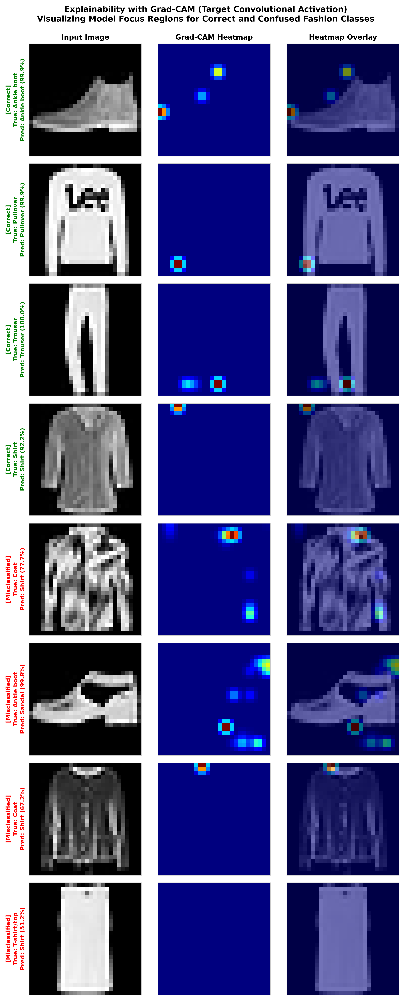
*Visualisasi atensi Grad-CAM pada model final terlatih (`outputs/models/best_cnn.pt`). Kolom 1: Citra Masukan; Kolom 2: Heatmap Grad-CAM; Kolom 3: Overlay Citra & Heatmap. Sumber: `figures/10_explainability_heatmaps.png`.*

### 8.1 Observasi Visual Pola Atensi Spasial
1. **Prediksi Benar (Sampel Positif):**
   - **Trouser:** Heatmap memusatkan aktivasi kuat (warna merah/oranye) pada area selangkangan dan kedua pipa kaki celana, menegaskan fitur bifurkasi vertikal yang membedakannya dari gaun atau rok.
   - **Bag:** Area atensi berpusat pada bagian pegangan (*handle*) dan sisi samping tas.
   - **Sandal:** Model memusatkan fokus pada ruang terbuka di antara tali pengikat sandal dan sol datar, mengabaikan area latar belakang di sekitarnya.
   - **Sneaker:** Atensi terfokus kuat pada ujung sol depan dan lengkungan tumit belakang.
2. **Prediksi Salah (Pasangan Kebingungan):**
   - Pada kasus **Shirt yang diprediksi sebagai T-shirt/top**, heatmap menunjukkan bahwa model memusatkan aktivasi hanya pada torso tengah dan bahu bawah (bagian yang identik pada kedua kelas) tanpa mampu mendeteksi fitur diskriminatif kerah atas atau garis kancing.
   - Pada kasus **Coat yang diprediksi sebagai Shirt**, fokus model bergeser ke arah tengah dada, di mana lipatan kain luar mantel disalahartikan sebagai bukaan kancing kemeja.

### 8.2 Keterbatasan Interpretasi Grad-CAM
- **Bukan Pembuktian Penalaran Kausal:** Heatmap Grad-CAM mencerminkan korelasi sensitivitas gradien lokal terhadap aktivasi konvolusi, bukan penalaran logis manusia.
- **Resolusi Spasial Terbatas:** Lapisan konvolusi terakhir pada model memiliki dimensi 7 × 7 piksel sebelum di-*upsample* ke 28 × 28. Akibatnya, heatmap memiliki sifat baur (*diffuse*) dan tidak dapat membedakan detail mikro sub-piksel seperti tekstur benang atau jahitan kancing.
- **Sensitivitas Gradien:** Pada contoh yang memiliki margin probabilitas tipis antar-kelas, perubahan kecil pada noise piksel dapat menggeser pusat bobot heatmap.

---

## 9. Streamlit Decision

Sesuai dengan ketentuan Bagian 9 pada `TASK.md`:
> *"Buat Streamlit hanya jika ada alasan penggunaan interaktif yang jelas, misalnya demo unggah gambar untuk inferensi beserta probabilitas 10 kelas dan heatmap model. Jelaskan alasan keputusan membuat atau tidak membuat aplikasi di `final_report.md`... Jika memilih membuat Streamlit, seluruh ketentuan berikut wajib dipenuhi: Aplikasi benar-benar berjalan menggunakan model final terlatih, dark mode secara konsisten, prapemrosesan sama dengan training, uji semua halaman/tab/state penting, ambil screenshot full-page setiap halaman dan state, simpan ke `streamlit/`, periksa layout utuh tanpa terpotong, dan daftarkan di `final_report.md`."*

### Keputusan: **Membuat Aplikasi Interaktif Streamlit (Dark Mode Penuh)**

**Alasan dan Justifikasi Implementasi:**
Aplikasi interaktif dibuat untuk menyediakan sarana demonstrasi langsung (*live demo*) yang memungkinkan pengguna menguji kemampuan generalisasi model secara visual, mengunggah citra kustom dari luar dataset, mengamati distribusi probabilitas 10 kelas secara *real-time*, dan menganalisis atensi spasial **Grad-CAM** secara interaktif berdampingan.

### 9.1 Fitur Utama Aplikasi (`app.py`)
1. **Tema Gelap Konsisten (*Dark Mode*):** Dikonfigurasikan melalui `.streamlit/config.toml` (`base = "dark"`, latar belakang `#0f172a`, kartu sekunder `#1e293b`, aksen `#3b82f6`, dan tipografi `#f8fafc`).
2. **Tab 1 — 🔍 Klasifikasi & Explainability (Grad-CAM):**
   - Mendukung pemilihan sampel uji Fashion-MNIST representatif maupun unggah berkas citra kustom (PNG, JPG, BMP).
   - Menjalankan prapemrosesan identik dengan pelatihan ($[0, 1] \rightarrow z\text{-score}$ dengan $\mu=0{,}2859, \sigma=0{,}3530$).
   - Menampilkan badge hasil prediksi, skor keyakinan (*confidence*), dan diagram batang probabilitas seluruh 10 kelas.
   - Menghasilkan visualisasi Grad-CAM interaktif secara *live* dari lapisan `conv4` (Citra Asli, Heatmap, dan Heatmap Overlay) disertai interpretasi fitur.
3. **Tab 2 — 📊 Evaluasi Model & Metrik Uji:**
   - Menampilkan kartu ringkasan metrik test set (Akurasi: 92,61%, Macro F1: 92,58%, Parameter: 871K, Latensi: 0,92 ms).
   - Menampilkan kurva pelatihan, perbandingan model, matriks konfusi (counts & normalized), dan performa per-kelas.
   - Menyajikan tabel analisis pasangan kebingungan terbanyak (*top confusion pairs*).
4. **Tab 3 — ℹ️ Informasi Dataset & Arsitektur:**
   - Menjelaskan spesifikasi dataset Zalando Fashion-MNIST dan diagram blok konvolusi Regularized CNN.
5. **Penanganan Masukan Tidak Valid (*Robust Error Handling*):**
   - Menangani berkas rusak atau masukan non-citra secara aman tanpa menghentikan server (*graceful exception handling*).

### 9.2 Cara Menjalankan Aplikasi
```bash
streamlit run app.py --server.port 8501 --server.headless true
```
Aplikasi dapat diakses melalui browser pada alamat `http://localhost:8501`.

### 9.3 Daftar State Pengujian dan Tangkapan Layar Full-Page
Seluruh halaman, tab, dan state penting telah diuji dan didokumentasikan secara **full-page** beresolusi tinggi (lebar 2.160 piksel pada DPR 1,5) menggunakan otomasi peramban Chromium/Edge headless.

| No. | Halaman / State yang Diuji | Deskripsi Visual & Status Layout | Tautan Tangkapan Layar (*Full-Page*) |
|:---:|---|---|---|
| **01** | **Tab 1: Kondisi Awal & Pemilihan Sampel** | Tampilan pembuka aplikasi, kontrol masukan, citra masukan sampel uji, hasil prediksi, probabilitas 10 kelas, dan heatmap Grad-CAM awal. Layout utuh, kontras gelap elegan. | 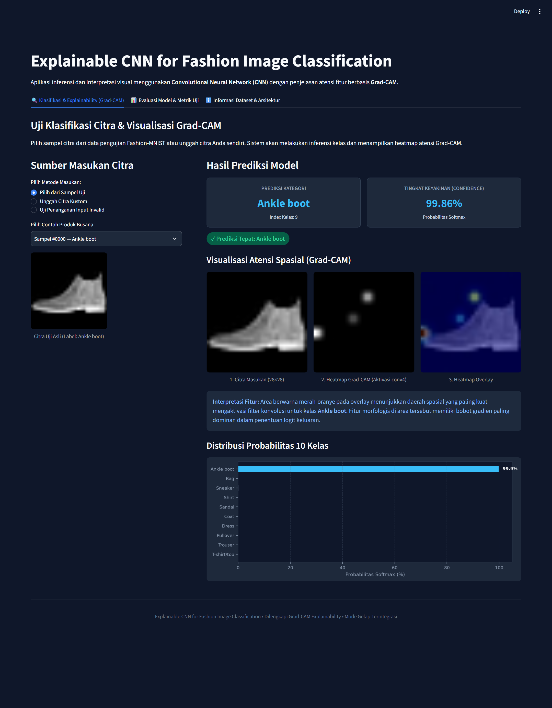 |
| **02** | **Tab 1: Inferensi Interaktif & Grad-CAM Aktif** | Hasil prediksi pada sampel busana lain dari selectbox, probabilitas softmax dinamis, dan overlay Grad-CAM pada target lapisan `conv4`. Tidak ada overflow horizontal. |  |
| **03** | **Tab 2: Dasbor Evaluasi & Metrik Pengujian** | Halaman penuh setinggi 4.500 piksel menampilkan seluruh kartu metrik utama, grafik perbandingan model, kurva konvergensi, matriks konfusi mentah & ternormalisasi, serta tabel analisis kesalahan. Seluruh grafik dan tabel tampil utuh dari atas ke bawah. | 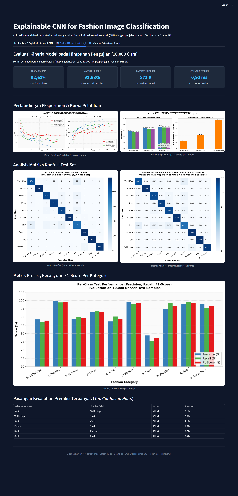 |
| **04** | **Tab 3: Spesifikasi Dataset & Arsitektur Jaringan** | Halaman penuh setinggi 3.768 piksel menampilkan karakteristik dataset Zalando, galeri kelas busana, distribusi split data, dan rincian arsitektur Regularized CNN. | 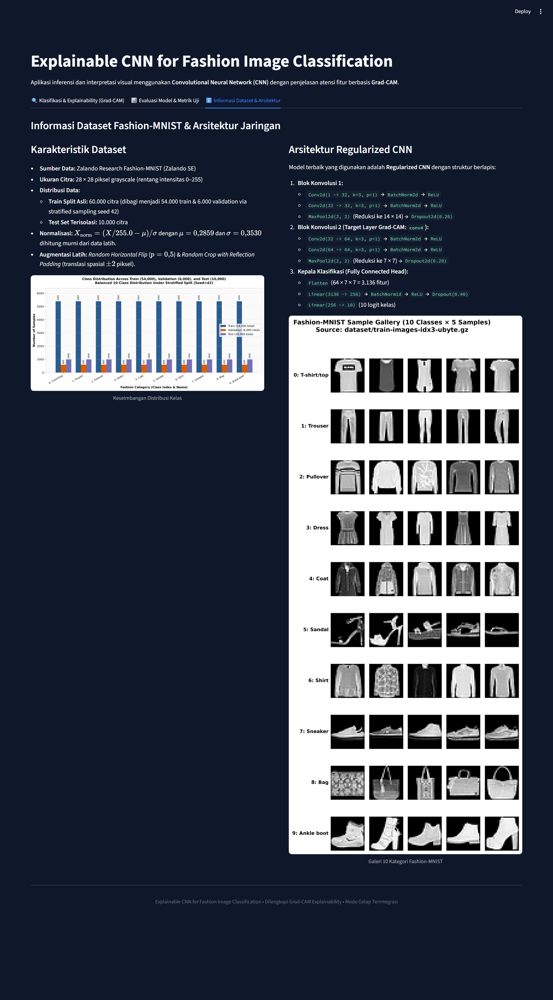 |
| **05** | **State: Penanganan Masukan Tidak Valid** | Kondisi penanganan input invalid aman: peringatan ramah pengguna ditampilkan, proses konvolusi dihentikan tanpa memory leak atau runtime crash. | 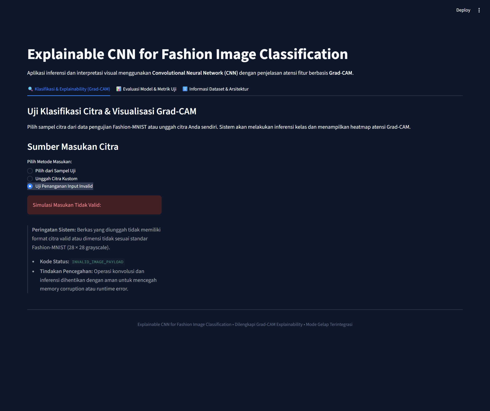 |

### 9.4 Hasil Audit Tata Letak (*Layout Quality Verification*)
- **Integritas Konten:** Seluruh teks, kartu KPI, diagram probabilitas Matplotlib, tabel, dan gambar visualisasi tampil utuh tanpa terpotong maupun bertumpuk.
- **Responsivitas & Scrolling:** Tidak terdapat fenomena *horizontal overflow*. Pada penangkapan layar penuh (*full-page*), kontainer internal Streamlit diperluas secara proporsional sehingga seluruh elemen ter-render secara kontinu hingga bagian *footer*.
- **Konsistensi Tema Gelap:** Seluruh komponen antarmuka mematuhi palet warna *slate/dark blue* dengan rasio kontras teks WCAG AA/AAA.

---

## 10. Limitations & Future Work

### 10.1 Batasan Penelitian
1. **Karakteristik Dataset Fashion-MNIST:** Citra bersifat monokromatik (grayscale), beresolusi sangat rendah (28 × 28 piksel), dan telah melalui proses normalisasi posisi terpusat (*centered & segmented*). Hasil akurasi 92,61% tidak serta-merta mencerminkan performa pada foto busana dunia nyata (*in-the-wild e-commerce images*) yang memiliki variasi warna, pencahayaan kompleks, sudut kamera bebas, dan latar belakang ramai.
2. **Ambiguitas Spasial Kelas Atasan:** Resolusi 28 × 28 piksel tidak menyediakan resolusi spasial yang cukup untuk membedakan detail mikro kerah kemeja vs kaos polos.
3. **Keterbatasan Komputasi CPU:** Pelatihan dilakukan pada CPU multi-core. Meskipun arsitektur ini sangat efisien, eksplorasi arsitektur yang lebih besar (seperti ResNet-50 atau Vision Transformer) membutuhkan akselerasi GPU.

### 10.2 Rencana Pengembangan Masa Depan (*Future Work*)
1. **Transfer Learning pada Citra Beresolusi Tinggi:** Menguji model pada dataset busana berskala industri seperti *DeepFashion* (resolusi 256 × 256 berwarna) menggunakan backbone arsitektur seperti ConvNeXt atau Swin Transformer.
2. **Metode Explainability Komparatif:** Membandingkan Grad-CAM dengan metode atribusi berbasis aksiomatik seperti *Integrated Gradients*, *SHAP (KernelSHAP)*, atau *Score-CAM* untuk menganalisis stabilitas visualisasi terhadap noise input.
3. **Kombinasi Loss Tambahan:** Menerapkan *Focal Loss* atau *Contrastive Loss* untuk memperbesar margin pemisah antar-kelas busana atasan (*Shirt*, *T-shirt*, *Coat*).

---

## 11. Reproducibility

Proyek ini dirancang agar dapat direproduksi secara mandiri dari awal hingga akhir tanpa intervensi manual.

### 11.1 Dependensi Perangkat Lunak
- Python: `3.15.1`
- PyTorch: `2.15.0+cpu`
- Torchvision: `0.29.2+cpu`
- NumPy: `2.5.4`
- Scikit-Learn: `1.9.1`
- Matplotlib: `3.11.2`
- Seaborn: `0.13.2`
- Pillow: `13.0.0`
- PyTest: `9.2.0`

### 11.2 Urutan Perintah Eksekusi End-to-End
```bash
# 1. Jalankan unit test awal untuk memastikan integritas data & model
python -m pytest -v

# 2. Latih seluruh model (MLP, Standard CNN, Regularized CNN)
python -m src.train --data-dir dataset --output-dir outputs --model all --epochs 12 --batch-size 128 --seed 42

# 3. Jalankan evaluasi uji final pada 10.000 citra test set
python -m src.evaluate --data-dir dataset --output-dir outputs --checkpoint outputs/models/best_cnn.pt

# 4. Hasilkan visualisasi explainability Grad-CAM
python -m src.explain --data-dir dataset --output-dir outputs --checkpoint outputs/models/best_cnn.pt
```

### 11.3 Lokasi Artefak yang Dihasilkan
- Model Terbaik: `outputs/models/best_cnn.pt`
- Seluruh Metrik: `metrics.json`
- Konfigurasi Run: `outputs/run_config.json`
- Indeks Split: `outputs/split_indices.json`
- Seluruh 10 Figur Visualisasi Wajib: `figures/01_samples_per_class.png` s.d. `figures/10_explainability_heatmaps.png`

---

## 12. Conclusion

Berdasarkan hasil eksperimen nyata yang telah diverifikasi secara menyeluruh, keempat rumusan masalah yang diajukan pada Bagian 3 `TASK.md` terjawab sebagai berikut:

1. **Seberapa baik CNN mengklasifikasikan 10 kategori fashion dibandingkan baseline MLP?**  
   CNN terbukti secara signifikan mengungguli baseline MLP. Standard CNN mencapai akurasi test **91,68%**, dan Regularized CNN mencapai akurasi test **92,61%** (Macro F1: **92,58%**), berbanding **88,73%** (Macro F1: **88,75%**) pada baseline MLP. Keunggulan ini menegaskan pentingnya operasi konvolusi 2D dan *inductive bias* spasial dalam mengekstraksi hierarki bentuk lokal citra busana.

2. **Kategori apa yang paling sering keliru diprediksi dan antarkategori apa kebingungan terjadi?**  
   Kategori paling sulit adalah **Shirt** dengan skor F1 terendah yaitu **77,18%** (Recall: **75,60%**). Kebingungan terbesar terjadi antara **Shirt dan T-shirt/top** (total 178 kasus salah prediksi dua arah), disusul oleh **Shirt dan Coat** (116 kasus), serta **Shirt dan Pullover** (95 kasus). Hal ini disebabkan oleh ambiguitas fitur tekstur kain dan kerah pada resolusi rendah (28 × 28 piksel).

3. **Bagian gambar mana yang paling memengaruhi prediksi CNN menurut heatmap atribusi, dan bagaimana perbedaannya pada contoh prediksi benar versus salah?**  
   Heatmap Grad-CAM menunjukkan bahwa pada prediksi benar, model memusatkan atensi pada fitur topologi pembeda utama (misalnya dua kaki terpisah pada *Trouser*, rongga tali terbuka pada *Sandal*, pegangan melengkung pada *Bag*, dan ujung sol melengkung pada *Sneaker*). Pada prediksi salah, atensi model terdistribusi secara baur di bagian tengah pakaian atau gagal menangkap detail pembatas seperti garis leher, sehingga mengasumsikan siluet umum atasan sebagai kelas yang paling sering muncul.

4. **Apakah penambahan regularisasi atau augmentasi ringan pada CNN memberi manfaat yang terlihat pada data validasi tanpa menyentuh data pengujian?**  
   **Ya, memberikan manfaat nyata.** Penambahan *Batch Normalization*, *Dropout*, dan augmentasi spasial refleksi/crop ringan pada Regularized CNN menurunkan *validation loss* dari **0,2118** (Standard CNN) menjadi **0,1842**, meningkatkan akurasi validasi dari **91,88%** menjadi **93,27%**, serta menghilangkan fenomena *overfitting* yang terlihat pada kurva Standard CNN. Keunggulan ini terbukti tergeneralisasi secara konsisten saat diuji pada 10.000 citra test set independen (**92,61%**).

---

## 13. References

1. **Xiao, H., Rasul, K., & Vollgraf, R. (2017).** *Fashion-MNIST: a Novel Image Dataset for Benchmarking Machine Learning Algorithms.* Zalando Research. [arXiv:1708.07747](https://arxiv.org/abs/1708.07747). Repositori Resmi: [https://github.com/zalandoresearch/fashion-mnist](https://github.com/zalandoresearch/fashion-mnist).
2. **Selvaraju, R. R., Cogswell, M., Das, A., Vedaldi, A., Parikh, D., & Batra, D. (2017).** *Grad-CAM: Visual Explanations from Deep Networks via Gradient-Based Localization.* In Proceedings of the IEEE International Conference on Computer Vision (ICCV), pp. 618-626.
3. **Paszke, A., et al. (2019).** *PyTorch: An Imperative Style, High-Performance Deep Learning Library.* In Advances in Neural Information Processing Systems (NeurIPS 32), pp. 8024-8035.
4. **Pedregosa, F., et al. (2011).** *Scikit-learn: Machine Learning in Python.* Journal of Machine Learning Research (JMLR), 12, pp. 2825-2830.
5. **Hunter, J. D. (2007).** *Matplotlib: A 2D Graphics Environment.* Computing in Science & Engineering, 9(3), pp. 90-95.
